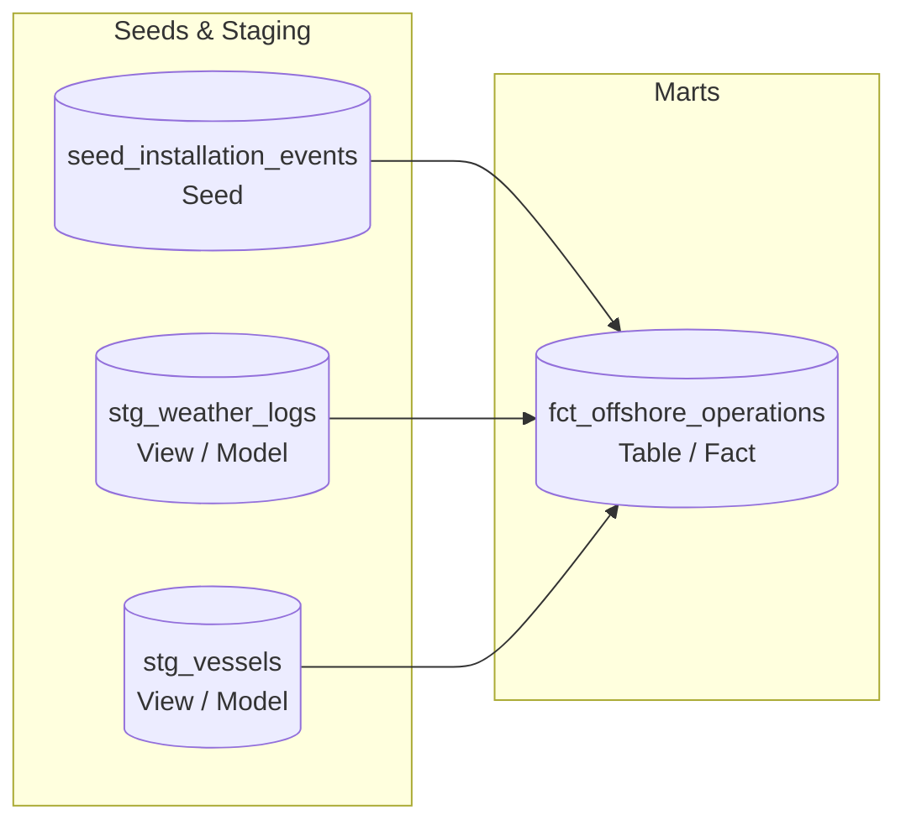

# Offshore Wind Fleet Analytics

End-to-end dbt + DuckDB analytics pipeline simulating offshore wind installation vessels, weather logs, and turbine installation operations.

## Tech Stack
- **Transformation & Testing**: dbt (`dbt-duckdb`)
- **Analytical Database**: DuckDB (`offshore_wind.duckdb`)
- **Synthetic Data**: Python (`simulate_vessels.py` -> `seeds/*.csv`)

## Project Structure
- `seeds/`: Raw CSV seed data (`seed_vessels`, `seed_weather_logs`, `seed_installation_events`)
- `models/staging/`: Staging models (`stg_vessels`, `stg_weather_logs`, etc.)
- `models/marts/`: Analytical fact model (`fct_offshore_operations`)
- `models/overview.md`: Custom dbt Docs landing page content

## How to Run Locally
```bash
dbt seed
dbt run
dbt test
dbt docs generate && dbt docs serve
```

## Lineage Graph

